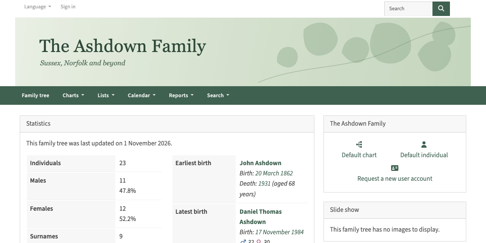
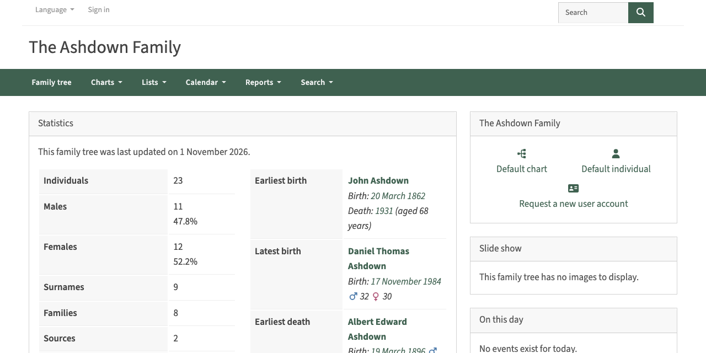
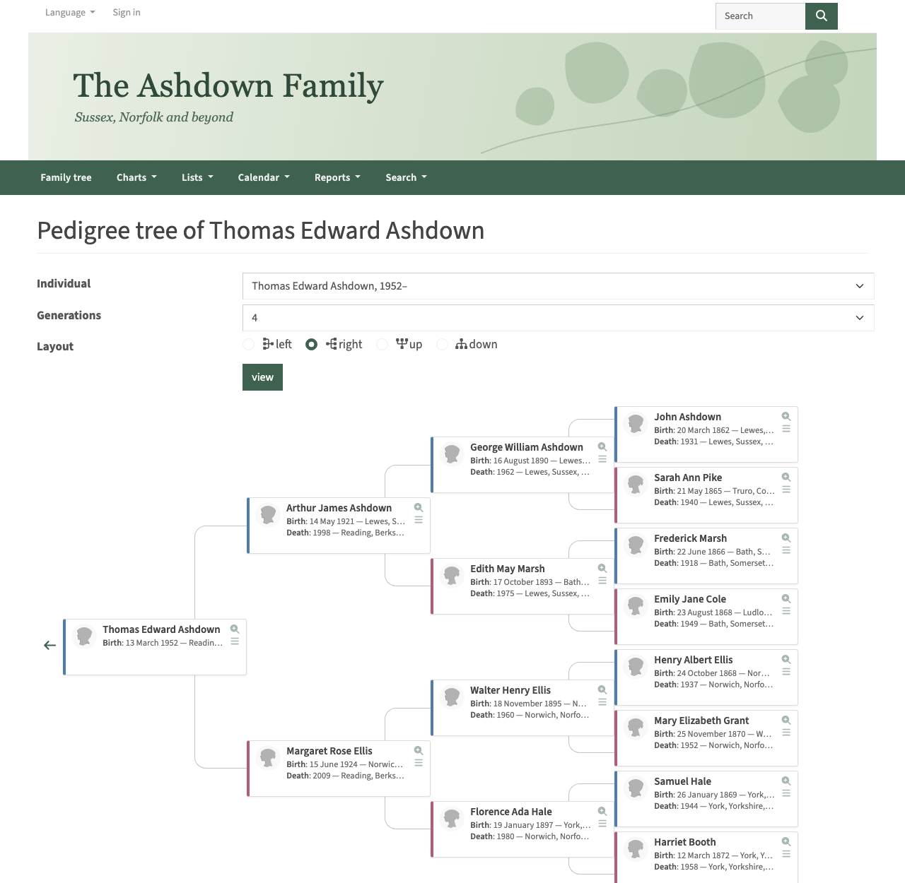
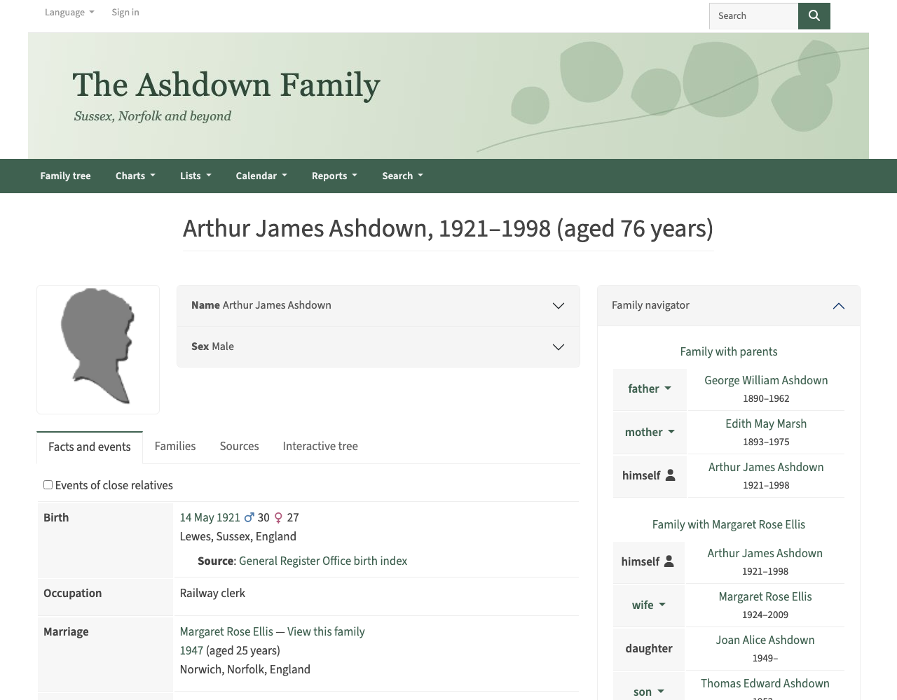
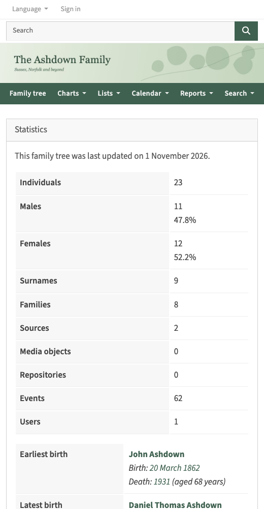
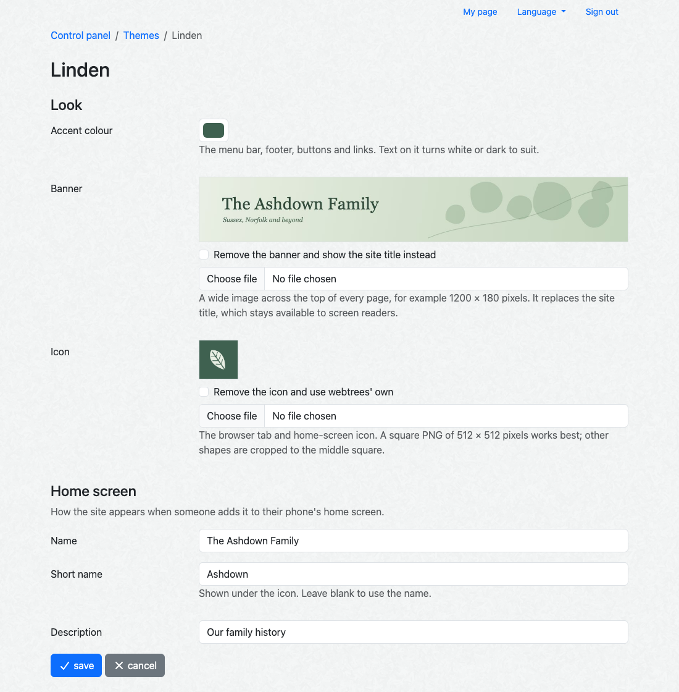
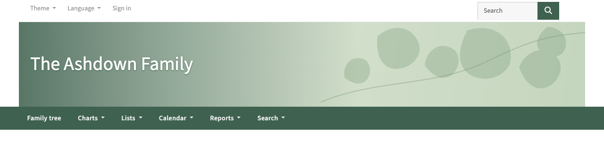

# Linden

A clean theme for [webtrees](https://webtrees.net) 2.2 that you can make your own without
touching any code: upload a banner and an icon, pick a colour, and you're done.

## Features

- **Your banner** across the top of every page, with or without the site title over it.
  Without one, the site title shows on its own.
- **Your colour** for the menu bar, footer, buttons and links. Text on it turns white or dark
  to suit, and links are darkened if need be so they stay readable on white.
- **Your icon** in browser tabs and on phone home screens. Upload one image and Linden makes
  the sizes browsers and phones ask for.
- **"Add to home screen"** with your site's own name and description.
- **Compact chart boxes**: name, birth and death on one line each, a small round photo, and a
  coloured edge for men and women. Long places are trimmed rather than wrapping.
- **A one-row footer**, and blocks that stack neatly on a phone.
- **Source Sans 3**, served from your own site (no calls to Google Fonts).
- Optionally keep the theme menu for administrators, so everyone else always sees Linden.

| Out of the box | Charts |
| --- | --- |
|  |  |
| **Individual page** | **On a phone** |
|  |  |

## Requirements

- webtrees 2.2 (tested with 2.2.6)
- PHP's GD extension with JPEG, PNG and WebP support, for the banner and icon uploads.
  Most hosts have it; webtrees uses it for thumbnails too.

## Installing

1. Download `linden-theme-<version>.zip` from the
   [latest release](https://github.com/SandTugBoat85/webtrees-theme-linden/releases/latest).
2. Unzip it into webtrees' `modules_v4` folder, so you have `modules_v4/linden-theme/module.php`.
3. In the control panel, go to **Modules > Themes** and check that Linden is enabled.
4. To make it everyone's theme, go to **Website preferences** and set **Default theme** to Linden.

To upgrade, replace the `linden-theme` folder with the new one. Your settings and images are
kept. webtrees checks for new versions of Linden once a day, and the control panel's front page
lists it under the custom modules with an upgrade available when there is one.

## Setting it up

Go to **Control panel > Modules > Themes** and click the preferences icon next to Linden.

- **Accent colour**: the menu bar, footer, buttons and links.
- **Banner**: any JPEG, PNG, GIF or WebP, ideally about 1200 × 180 pixels. It is scaled to fill
  the width of the page, so keep any lettering in it large: on a phone it shrinks with the image.
  For a picture without lettering, tick **Show the site title over the banner**.

  

- **Icon**: a square image, ideally 512 × 512 pixels. Other shapes are cropped to the middle.
- **Chart boxes**: tick "Show parents' ages at each birth" to show them in charts too.
- **Theme menu**: untick "Let everyone choose a theme" to keep the menu for administrators.
- **Home screen**: the name, short name and description used when someone adds your site to
  their phone's home screen. Left blank, webtrees' own are used.

If you'd like to try it before using your own pictures, there is an
[example banner](docs/example-banner.png) and [example icon](docs/example-icon.png) in `docs/`.

Uploaded images are re-encoded (which also strips camera details such as location) and stored in
webtrees' `data/linden-theme/` folder, so they are kept when you upgrade the theme and are
included in backups of your data folder.

## Licence

Linden is free software under the [GNU General Public License, version 3 or later](LICENSE.md),
the same licence as webtrees. The bundled Source Sans 3 fonts are © Adobe, under the
[SIL Open Font License](resources/fonts/OFL.txt).
